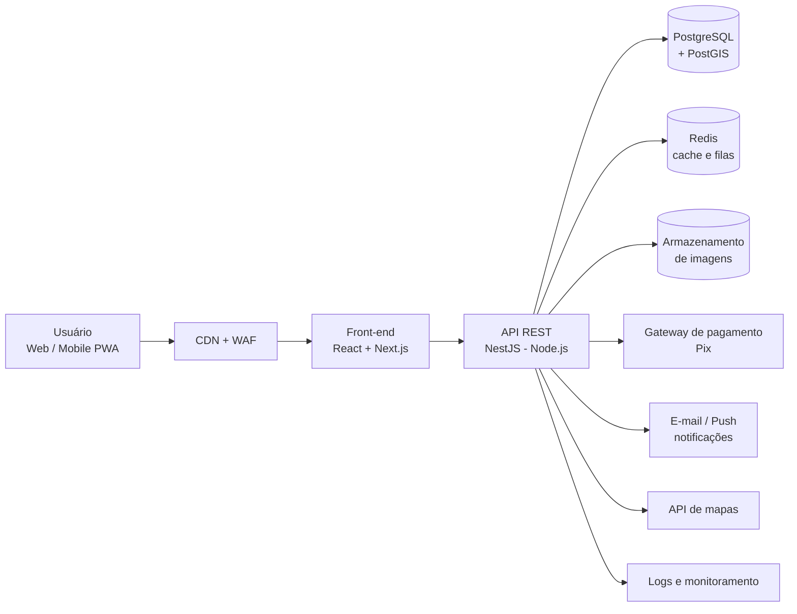
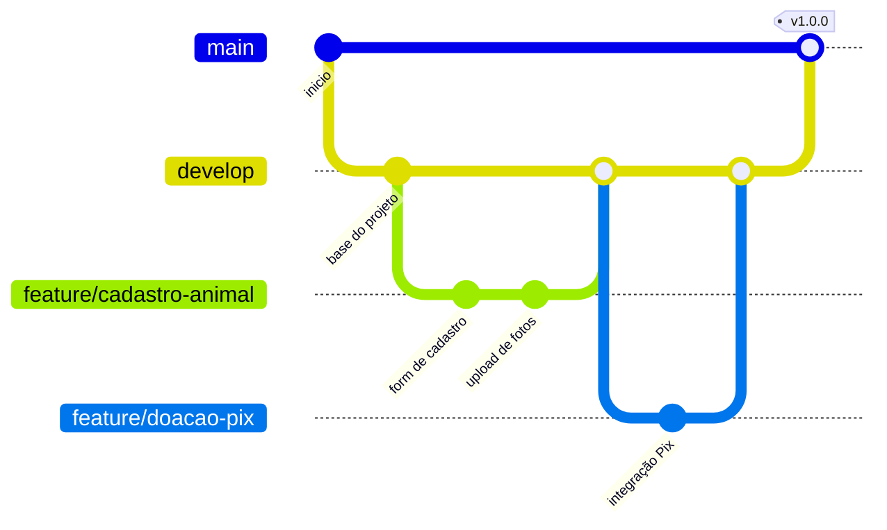
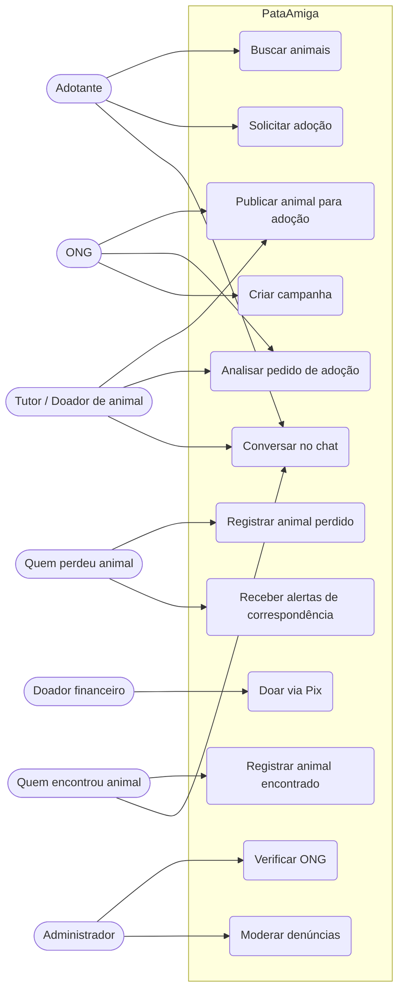
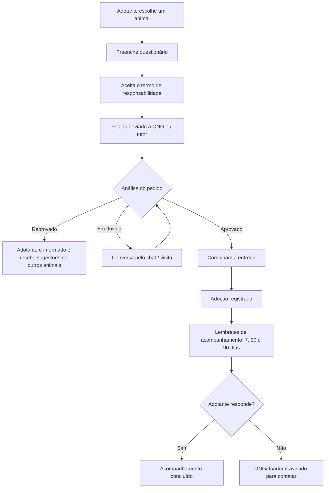
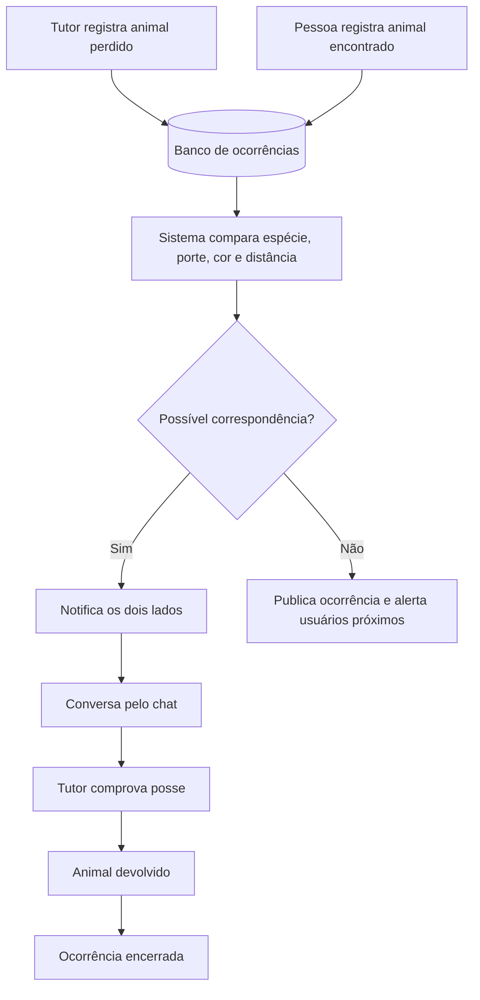
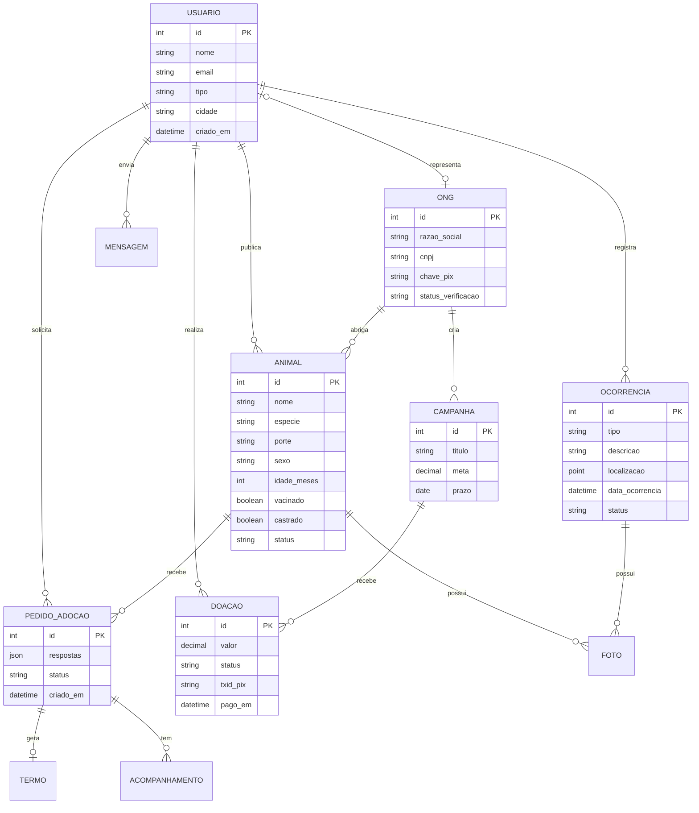
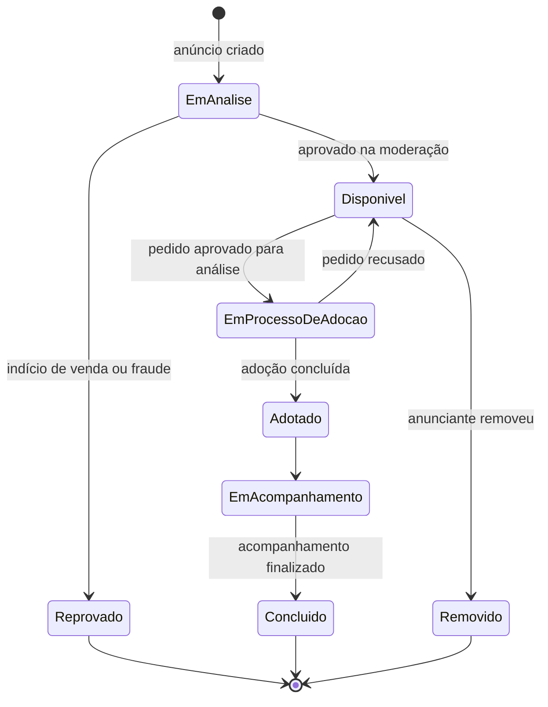

# 🐾 PataAmiga

> Plataforma web e mobile que conecta **ONGs e pessoas que querem doar animais**, quem **encontrou um animal perdido**, quem quer **adotar** e quem **perdeu o seu bichinho**, sempre com foco em **adoção responsável** e em **facilitar doações para ONGs**.

---

## 📑 Sumário

1. [Sobre o Projeto](#1-sobre-o-projeto)
2. [Tecnologias, Ferramentas e Infraestrutura](#2-tecnologias-ferramentas-e-infraestrutura)
3. [Metodologias Utilizadas](#3-metodologias-utilizadas)
4. [Projeto de Interface](#4-projeto-de-interface)
5. [Modelagem do Sistema](#5-modelagem-do-sistema)
6. [Planejamento](#6-planejamento)
7. [Estrutura do Repositório](#7-estrutura-do-repositório)

---

## 1. Sobre o Projeto

### O problema

Todos os dias animais são abandonados, se perdem ou ficam esperando um lar em ONGs que já estão superlotadas e com poucos recursos. Ao mesmo tempo, muitas pessoas querem adotar, mas não sabem onde procurar. Quem perde um animal, ou encontra um na rua, também costuma depender de grupos de redes sociais, onde as informações se perdem rápido.

### A solução

O **PataAmiga** é um sistema que reúne tudo em um só lugar:

- 🐶 **Adoção:** ONGs e pessoas publicam animais disponíveis com fotos e informações completas (espécie, porte, idade, temperamento, vacinas, castração, histórico de saúde, cidade).
- 🔍 **Animais perdidos e encontrados:** quem perdeu ou encontrou um animal publica a ocorrência com foto, local e data. O sistema cruza os dados e avisa usuários próximos.
- 💚 **Doações para ONGs:** cada ONG verificada tem um perfil com suas necessidades (ração, medicamentos, castração, lar temporário) e pode receber doações via Pix, direto na conta dela.
- 🤝 **Adoção responsável:** a plataforma estimula a adoção consciente, com triagem, termo de compromisso e acompanhamento pós-adoção.

### Objetivos

- Reduzir o tempo de permanência dos animais em abrigos e ONGs.
- Aumentar as chances de reencontro entre animais perdidos e seus tutores.
- Facilitar o recebimento de doações e voluntariado pelas ONGs.
- Combater o abandono, a devolução de animais e a comercialização irregular.

### Público-alvo

| Perfil | O que faz na plataforma |
|---|---|
| **Adotante** | Busca animais, preenche o questionário de adoção, acompanha o processo |
| **Doador de animal / Tutor** | Publica animal para adoção (com triagem e termo de responsabilidade) |
| **ONG** | Perfil verificado, gerencia animais, recebe doações e solicitações de adoção |
| **Quem encontrou um animal** | Registra o animal encontrado e conversa com possíveis tutores |
| **Quem perdeu um animal** | Registra o desaparecimento e recebe alertas de animais encontrados |
| **Doador financeiro / Voluntário** | Doa para ONGs, oferece lar temporário ou ajuda em eventos |
| **Administrador** | Verifica ONGs, modera publicações e trata denúncias |

### Adoção responsável (princípios do projeto)

Estes princípios orientam as regras de negócio do sistema:

1. **Proibida a venda de animais.** Anúncios com preço, "taxa de reserva" suspeita ou indícios de criação comercial são bloqueados e denunciáveis. ONGs podem cobrar apenas taxa de adoção opcional, registrada de forma transparente e que cubra os custos de vacina e castração.
2. **Questionário de adoção** (moradia, telas de proteção, experiência anterior, rotina, outros animais em casa, concordância da família) analisado pela ONG ou pelo doador antes de qualquer entrega.
3. **Termo de responsabilidade** digital aceito pelo adotante, com compromisso de vacinação, castração, não abandono e devolução ao doador ou à ONG caso não possa mais cuidar.
4. **Acompanhamento pós-adoção:** lembretes automáticos após 7, 30 e 90 dias para o adotante enviar foto e atualização do animal.
5. **Animais encontrados:** ao registrar um animal encontrado, o sistema orienta a verificar microchip, plaquinha e a registrar boletim ou comunicar a prefeitura quando aplicável. A entrega ao suposto tutor exige comprovação de posse (fotos antigas, carteira de vacinação, características que só o tutor conhece).
6. **Verificação das ONGs:** cadastro com CNPJ, documentos e aprovação manual do administrador antes de receber o selo de "ONG verificada" e liberar doações.
7. **Privacidade:** o endereço exato de quem encontrou o animal não é exibido publicamente (apenas região aproximada). O contato é feito pelo chat interno.

### Funcionalidades principais

**Requisitos Funcionais (RF)**

- **RF01** – Cadastro e login de usuários (e-mail e Google), com perfis diferentes (pessoa física, ONG)
- **RF02** – Cadastro de ONGs com envio de documentos e verificação pelo administrador
- **RF03** – Publicar animal para adoção com várias fotos e ficha completa
- **RF04** – Buscar e filtrar animais (espécie, porte, idade, sexo, cidade, ONG, castrado, vacinado)
- **RF05** – Registrar animal perdido e animal encontrado, com foto, local e data
- **RF06** – Mapa com ocorrências de animais perdidos e encontrados
- **RF07** – Alertas por região e sugestão de possíveis correspondências (mesma espécie, porte, cor e local próximo)
- **RF08** – Questionário de adoção e fluxo de aprovação (solicitada → em análise → aprovada → concluída)
- **RF09** – Termo de responsabilidade digital
- **RF10** – Chat interno entre as partes
- **RF11** – Doação via Pix para ONGs, com comprovante e transparência (quanto foi arrecadado e para quê)
- **RF12** – Campanhas de ONGs (ex.: "ração para o mês", "castração solidária") com meta e barra de progresso
- **RF13** – Acompanhamento pós-adoção com lembretes
- **RF14** – Denúncia de anúncios suspeitos e moderação
- **RF15** – Favoritar animais e receber notificações de novos animais com o perfil desejado
- **RF16** – Compartilhar o anúncio em redes sociais (cartaz digital pronto para imprimir ou postar)

**Requisitos Não Funcionais (RNF)**

- **RNF01** – Responsivo e funcional em celulares simples (PWA)
- **RNF02** – Conformidade com a **LGPD** (consentimento, exclusão de dados, minimização)
- **RNF03** – Fotos otimizadas automaticamente (compressão e miniaturas)
- **RNF04** – Autenticação segura (senhas com hash, JWT, proteção contra força bruta)
- **RNF05** – Disponibilidade mínima de 99% e backups diários
- **RNF06** – Acessibilidade (WCAG 2.1 nível AA) e textos alternativos nas fotos
- **RNF07** – Tempo de carregamento da listagem inferior a 3 segundos em 4G

---

## 2. Tecnologias, Ferramentas e Infraestrutura

### Visão geral da arquitetura



### Stack

| Camada | Tecnologia | Por que foi escolhida |
|---|---|---|
| **Front-end Web/PWA** | React + Next.js + TypeScript | Boa performance, SEO para as páginas de animais e funciona como PWA no celular |
| **Estilização** | Tailwind CSS | Rapidez para criar interfaces responsivas e consistentes |
| **Back-end** | Node.js + NestJS (TypeScript) | Estrutura organizada em módulos e mesma linguagem do front-end |
| **Banco de dados** | PostgreSQL + extensão PostGIS | Banco relacional robusto e consultas por proximidade ("animais perto de mim") |
| **Cache e filas** | Redis | Cache de listagens e fila para e-mails e notificações |
| **Armazenamento de imagens** | AWS S3 (ou compatível) + CDN | Guarda as fotos fora do servidor e entrega rápido |
| **Autenticação** | JWT + OAuth 2.0 (Google) | Login seguro e prático |
| **Pagamentos** | Pix via gateway (ex.: Mercado Pago ou Pagar.me) | Doações instantâneas e de baixo custo, com divisão direto para a conta da ONG |
| **Mapas** | OpenStreetMap + Leaflet (ou Google Maps API) | Mapa de ocorrências sem custo inicial |
| **Notificações** | Firebase Cloud Messaging + e-mail (SMTP) | Alertas de animais perdidos e adoções |
| **Testes** | Jest, Supertest e Cypress | Testes unitários, de API e ponta a ponta |
| **Documentação da API** | Swagger / OpenAPI | Facilita a integração entre equipe de front e back |

### Infraestrutura e DevOps

| Item | Ferramenta |
|---|---|
| **Cloud** | AWS (EC2 ou ECS, RDS para o PostgreSQL, S3, CloudFront) |
| **Contêineres** | Docker e Docker Compose (ambiente local igual ao de produção) |
| **CI/CD** | GitHub Actions (testes, lint e deploy automático) |
| **Ambientes** | `desenvolvimento`, `homologação` e `produção` |
| **Monitoramento** | Grafana + Prometheus, Sentry para erros |
| **Segurança** | HTTPS (TLS), WAF, variáveis de ambiente em gerenciador de segredos, backups automáticos |

### Ferramentas de apoio

| Finalidade | Ferramenta |
|---|---|
| Controle de versão | Git + GitHub |
| Gestão de tarefas | GitHub Projects (Kanban) e Issues |
| Prototipação | Figma |
| Diagramas | Mermaid (dentro do próprio README), draw.io |
| Comunicação da equipe | Discord ou WhatsApp, reuniões semanais |
| Editor | Visual Studio Code |

---

## 3. Metodologias Utilizadas

### 3.1 Qual metodologia e por quê?

**Escolha: metodologia ágil, usando o framework Scrum com quadro Kanban.**

| Critério | Cascata | Espiral | **Scrum (escolhido)** |
|---|---|---|---|
| Requisitos mudam durante o projeto? | Não aceita bem mudanças | Aceita, mas com muito planejamento | **Aceita mudanças a cada sprint** |
| Entregas parciais funcionando | Só no final | A cada ciclo, com foco em análise de risco | **A cada sprint (1 a 2 semanas)** |
| Complexidade de gestão | Baixa | Alta (exige análise de riscos formal) | **Média, simples para equipes pequenas** |
| Feedback de usuários reais (ONGs e adotantes) | Tarde demais | Ao fim de cada ciclo | **Contínuo** |
| Adequação a equipe pequena/estudantil | Média | Baixa | **Alta** |

**Justificativa:** o PataAmiga lida com pessoas e ONGs reais, e é natural que muitas necessidades só apareçam ao testar com elas (por exemplo, quais perguntas o questionário de adoção realmente precisa ter). A cascata exigiria definir tudo antes e só entregaria no fim, o que aumenta muito o risco de construir algo que ninguém usa. O modelo espiral é excelente para projetos de alto risco e alto custo, mas exige uma análise formal de riscos a cada ciclo, o que seria pesado para uma equipe pequena. O Scrum permite entregar valor aos poucos, ajustar o rumo rapidamente e manter a equipe organizada.

> Os riscos mais importantes (fraude, venda disfarçada de animais, vazamento de dados) são tratados no próprio backlog, como histórias de usuário de prioridade alta, e revisados a cada Sprint Review.

### 3.2 Como o Scrum será aplicado

| Elemento | Como será no projeto |
|---|---|
| **Product Owner** | Define e prioriza o backlog com base nas necessidades de ONGs e adotantes |
| **Scrum Master** | Facilita as reuniões e remove impedimentos |
| **Time de desenvolvimento** | Front-end, back-end, banco de dados, interface e testes |
| **Sprints** | 2 semanas cada |
| **Planning** | Início da sprint: escolher as histórias que cabem no tempo |
| **Daily** | Rápida (15 min) ou assíncrona, por mensagem |
| **Review** | Demonstração do que foi feito, de preferência com uma ONG parceira |
| **Retrospectiva** | O que deu certo, o que melhorar |
| **Artefatos** | Product Backlog, Sprint Backlog, Incremento, Definition of Done |

**Histórias de usuário** seguem o formato: *"Como [perfil], quero [ação], para [benefício]"*. Exemplo:

> Como **ONG verificada**, quero criar uma campanha de arrecadação com meta e prazo, para que doadores acompanhem o quanto falta para o castramóvel acontecer.

**Priorização (MoSCoW):**

| Prioridade | Funcionalidades |
|---|---|
| **Must have** | Cadastro/login, publicar animal, busca, questionário e termo de adoção, verificação de ONG |
| **Should have** | Animais perdidos e encontrados com mapa, chat, doação via Pix |
| **Could have** | Campanhas com meta, alertas por proximidade, cartaz automático |
| **Won't have (por ora)** | Aplicativo nativo, telemedicina veterinária, marketplace de produtos |

**Definition of Done (critérios para considerar uma história pronta):**

- [ ] Código revisado por pelo menos 1 colega (Pull Request aprovado)
- [ ] Testes automatizados passando
- [ ] Critérios de aceite validados pelo Product Owner
- [ ] Documentação atualizada
- [ ] Deploy em homologação funcionando

### 3.3 Como o Git e o GitHub serão usados

**Fluxo de branches (GitHub Flow simplificado + `develop`):**



| Branch | Função |
|---|---|
| `main` | Versão estável, em produção. **Protegida**: só recebe merge via Pull Request |
| `develop` | Integração das novidades; base para homologação |
| `feature/nome-da-funcionalidade` | Uma branch para cada história de usuário |
| `fix/nome-do-bug` | Correções de bugs |
| `hotfix/nome` | Correção urgente em produção |

**Padrão de commits (Conventional Commits):**

```text
feat: adiciona upload de múltiplas fotos do animal
fix: corrige filtro de cidade na busca
docs: atualiza README com diagrama de classes
test: cria testes do questionário de adoção
refactor: separa serviço de notificações
```

**Boas práticas adotadas:**

- Commits pequenos e com mensagens claras.
- **Pull Request obrigatório** para entrar em `develop` e `main`, com revisão de pelo menos 1 pessoa.
- **Issues** para cada tarefa e bug, ligadas ao quadro Kanban (GitHub Projects) com colunas: `Backlog → A fazer → Em andamento → Em revisão → Concluído`.
- **Labels** para organizar: `feature`, `bug`, `documentação`, `prioridade-alta`, `adoção-responsável`.
- **Milestones** para marcar as entregas (MVP, versão 1.0 etc.).
- **GitHub Actions** rodando testes e lint a cada Pull Request.
- **Versionamento semântico** (`v1.0.0`) com Releases publicadas no GitHub.
- Arquivos `CONTRIBUTING.md`, `CODE_OF_CONDUCT.md` e templates de Issue e Pull Request.
- **Nunca** subir senhas, chaves de API ou arquivos `.env` (usar `.gitignore` e GitHub Secrets).

---

## 4. Projeto de Interface

As telas abaixo são **protótipos de baixa fidelidade (wireframes)** desenhados em texto, para dar uma ideia da organização de cada página.

**Princípios de design:** cores acolhedoras (verde-água, laranja e branco), fotos grandes dos animais, botões de ação sempre visíveis, textos simples e poucos passos para cada tarefa.

### 4.1 Tela inicial (Home)

```text
┌──────────────────────────────────────────┐
│ 🐾 PataAmiga        [Entrar] [Cadastrar] │
├──────────────────────────────────────────┤
│                                          │
│   Todo animal merece um lar de verdade.  │
│                                          │
│   [ 🐶 Quero adotar ]  [ 🏠 Quero doar ] │
│   [ 🔍 Perdi / Achei um animal ]         │
│   [ 💚 Quero ajudar uma ONG ]            │
│                                          │
├──────────────────────────────────────────┤
│  Perto de você                  Ver todos│
│ ┌────────┐ ┌────────┐ ┌────────┐         │
│ │  FOTO  │ │  FOTO  │ │  FOTO  │         │
│ │ Thor   │ │ Mel    │ │ Bidu   │         │
│ │ Cão·M  │ │ Gata·P │ │ Cão·G  │         │
│ │ ONG ✔  │ │ Tutor  │ │ ONG ✔  │         │
│ └────────┘ └────────┘ └────────┘         │
├──────────────────────────────────────────┤
│  🚨 Animais perdidos na sua região       │
│  ▸ Cachorro caramelo – Centro – há 2 h   │
│  ▸ Gata cinza – Vila Nova – ontem        │
├──────────────────────────────────────────┤
│  ONGs que precisam de ajuda              │
│  Patas Unidas  ████████░░ 80% da meta    │
│  [ Doar agora ]                          │
└──────────────────────────────────────────┘
```

### 4.2 Busca de animais para adoção

```text
┌──────────────────────────────────────────┐
│ ← Adotar                                 │
├──────────────────────────────────────────┤
│ 🔎 [ Buscar por nome ou raça...        ] │
│                                          │
│ Filtros: [Espécie ▾] [Porte ▾] [Idade ▾] │
│          [Sexo ▾] [Cidade ▾]             │
│          ☐ Castrado  ☐ Vacinado          │
│          ☐ Somente ONGs verificadas      │
├──────────────────────────────────────────┤
│ ┌──────────────────────────────────────┐ │
│ │ [  FOTO  ]  Thor, 2 anos             │ │
│ │             Cão · Médio · Macho      │ │
│ │             ✔ Castrado ✔ Vacinado    │ │
│ │             Patas Unidas (ONG ✔)     │ │
│ │             São Carlos - SP    ♡     │ │
│ └──────────────────────────────────────┘ │
│ ┌──────────────────────────────────────┐ │
│ │ [  FOTO  ]  Mel, 6 meses             │ │
│ │             Gato · Pequeno · Fêmea   │ │
│ │             ✔ Vacinada               │ │
│ │             Tutor particular   ♡     │ │
│ └──────────────────────────────────────┘ │
│            [ Carregar mais ]             │
└──────────────────────────────────────────┘
```

### 4.3 Página do animal

```text
┌──────────────────────────────────────────┐
│ ← Voltar                      ♡   ⤴     │
├──────────────────────────────────────────┤
│ ┌──────────────────────────────────────┐ │
│ │                                      │ │
│ │         FOTO PRINCIPAL               │ │
│ │                                      │ │
│ └──────────────────────────────────────┘ │
│  [foto2] [foto3] [foto4] [vídeo]         │
├──────────────────────────────────────────┤
│  Thor                       DISPONÍVEL   │
│  Cão · SRD · Macho · 2 anos · Médio      │
│                                          │
│  Temperamento: dócil, brincalhão         │
│  Convive bem com: crianças ✔  gatos ✔    │
│  Saúde: vacinado ✔  castrado ✔           │
│         vermifugado ✔                    │
│  Sobre: Resgatado na rua em 2025...      │
├──────────────────────────────────────────┤
│  Publicado por: Patas Unidas  ✔ VERIFICADA│
│  Cidade: São Carlos - SP                 │
├──────────────────────────────────────────┤
│  ⚠ Adoção é compromisso por toda a vida  │
│    do animal. Leia o termo antes.        │
│                                          │
│  [ ❤ Quero adotar o Thor ]               │
│  [ 💬 Conversar ]  [ 🚩 Denunciar ]      │
└──────────────────────────────────────────┘
```

### 4.4 Questionário de adoção (adoção responsável)

```text
┌──────────────────────────────────────────┐
│ ← Pedido de adoção – Thor      Etapa 2/4 │
│ ████████████░░░░░░░░                     │
├──────────────────────────────────────────┤
│  Sobre a sua moradia                     │
│                                          │
│  Tipo de moradia                         │
│  (•) Casa  ( ) Apartamento  ( ) Chácara  │
│                                          │
│  Possui telas de proteção / muros altos? │
│  (•) Sim   ( ) Não                       │
│                                          │
│  Todos da casa concordam com a adoção?   │
│  (•) Sim   ( ) Não                       │
│                                          │
│  Já teve animais? Conte como foi:        │
│  [______________________________________]│
│                                          │
│  Quem cuidará do animal nas viagens?     │
│  [______________________________________]│
│                                          │
│       [ ← Voltar ]     [ Continuar → ]   │
└──────────────────────────────────────────┘
```

### 4.5 Termo de responsabilidade

```text
┌──────────────────────────────────────────┐
│ ← Termo de Adoção Responsável  Etapa 4/4 │
├──────────────────────────────────────────┤
│  Eu me comprometo a:                     │
│                                          │
│  ☑ Cuidar do animal por toda a sua vida  │
│  ☑ Manter vacinas e vermífugo em dia     │
│  ☑ Castrar o animal (quando aplicável)   │
│  ☑ Nunca abandonar, vender ou doar a     │
│     terceiros sem avisar o responsável   │
│  ☑ Devolver à ONG/doador se eu não puder │
│     mais cuidar                          │
│  ☑ Aceitar acompanhamento pós-adoção     │
│                                          │
│  Nome: Maria S.     CPF: ***.***.***-12  │
│                                          │
│  ☑ Li e concordo com o termo             │
│                                          │
│        [ Enviar pedido de adoção ]       │
└──────────────────────────────────────────┘
```

### 4.6 Cadastrar animal para adoção

```text
┌──────────────────────────────────────────┐
│ ← Anunciar animal para adoção            │
├──────────────────────────────────────────┤
│  Fotos (mínimo 2, máximo 8)              │
│  [ + ] [ + ] [ + ] [ + ]                 │
│                                          │
│  Nome:      [__________________]         │
│  Espécie:   [ Cão ▾ ]  Sexo: [ M ▾ ]     │
│  Raça:      [ SRD ▾ ]  Porte: [ Médio ▾ ]│
│  Idade:     [ 2 ] [ anos ▾ ]             │
│                                          │
│  Saúde:                                  │
│  ☐ Vacinado  ☐ Castrado  ☐ Vermifugado   │
│  ☐ Possui necessidades especiais         │
│                                          │
│  Temperamento / história:                │
│  [______________________________________]│
│                                          │
│  Motivo da doação:                       │
│  [ Selecione ▾ ]                         │
│                                          │
│  ☐ Declaro que este animal NÃO está à    │
│    venda e que sou o responsável por ele │
│                                          │
│            [ Publicar anúncio ]          │
└──────────────────────────────────────────┘
```

### 4.7 Animais perdidos e encontrados (mapa)

```text
┌──────────────────────────────────────────┐
│ ← Perdidos e Encontrados                 │
│ [ 🔴 Perdidos ]  [ 🟢 Encontrados ]      │
├──────────────────────────────────────────┤
│ ┌──────────────────────────────────────┐ │
│ │                  MAPA                │ │
│ │      🔴              🟢              │ │
│ │              📍 você                 │ │
│ │   🔴                      🔴         │ │
│ │                                      │ │
│ └──────────────────────────────────────┘ │
│  Raio: [ 5 km ▾ ]                        │
├──────────────────────────────────────────┤
│ ┌──────────────────────────────────────┐ │
│ │ [FOTO] 🔴 PERDIDO – Bidu             │ │
│ │ Cão pequeno, pelo preto, coleira azul│ │
│ │ Visto por último: Centro · há 3 h    │ │
│ │ Recompensa: não informada            │ │
│ │ [ Eu vi este animal ]                │ │
│ └──────────────────────────────────────┘ │
│                                          │
│  [ + Registrar animal perdido ]          │
│  [ + Registrar animal encontrado ]       │
└──────────────────────────────────────────┘
```

### 4.8 Registrar animal encontrado

```text
┌──────────────────────────────────────────┐
│ ← Encontrei um animal                    │
├──────────────────────────────────────────┤
│  ℹ Antes de continuar:                   │
│  • Procure plaquinha ou microchip        │
│    (veterinários fazem a leitura grátis) │
│  • Mantenha o animal em local seguro     │
│                                          │
│  Fotos:  [ + ] [ + ] [ + ]               │
│  Espécie: [ Cão ▾ ]  Porte: [ Pequeno ▾ ]│
│  Cor/características:                    │
│  [______________________________________]│
│                                          │
│  Onde encontrou?  [ 📍 Usar minha local. ]│
│  (o endereço exato não será divulgado)   │
│                                          │
│  Pode ficar com o animal por enquanto?   │
│  (•) Sim  ( ) Não, preciso de ajuda      │
│                                          │
│  Já tem coleira/plaquinha?  ( ) Sim (•)Não│
│                                          │
│          [ Publicar ocorrência ]         │
└──────────────────────────────────────────┘
```

### 4.9 Perfil da ONG e doação

```text
┌──────────────────────────────────────────┐
│ ← Patas Unidas        ✔ ONG VERIFICADA   │
├──────────────────────────────────────────┤
│  [LOGO]  São Carlos - SP                 │
│  Resgatamos e cuidamos de cães e gatos   │
│  desde 2018. 42 animais sob cuidados.    │
│                                          │
│  [ Ver animais ]  [ Ser voluntário ]     │
├──────────────────────────────────────────┤
│  📣 Campanha ativa                       │
│  Castração solidária – 20 animais        │
│  R$ 3.200 de R$ 4.000                    │
│  ████████████████░░░░  80%               │
│                                          │
│  Valor da doação:                        │
│  [ R$ 10 ] [ R$ 25 ] [ R$ 50 ] [Outro]   │
│                                          │
│  ☐ Doação mensal                         │
│                                          │
│       [ 💚 Doar com Pix ]                │
│                                          │
│  Transparência: ver prestação de contas  │
├──────────────────────────────────────────┤
│  Precisamos de: ração · cobertores ·     │
│  lar temporário                          │
└──────────────────────────────────────────┘
```

### 4.10 Pagamento via Pix

```text
┌──────────────────────────────────────────┐
│ ← Doação para Patas Unidas               │
├──────────────────────────────────────────┤
│  Valor: R$ 25,00                         │
│                                          │
│        ┌────────────────┐                │
│        │   ▓▓ QR CODE   │                │
│        │   ▓▓  PIX  ▓▓  │                │
│        └────────────────┘                │
│                                          │
│  [ 📋 Copiar código Pix ]                │
│                                          │
│  O valor vai direto para a conta da ONG. │
│  A plataforma não retém a doação.        │
│                                          │
│  Aguardando pagamento... ⏳              │
│                                          │
│  Quer receber comprovante por e-mail?    │
│  [ voce@email.com ]                      │
└──────────────────────────────────────────┘
```

### 4.11 Painel da ONG

```text
┌──────────────────────────────────────────┐
│ Painel – Patas Unidas              👤    │
├──────────────────────────────────────────┤
│  Resumo                                  │
│  🐶 Animais ativos: 42                   │
│  📩 Pedidos de adoção: 7 (3 novos)       │
│  💚 Arrecadado no mês: R$ 2.150          │
│                                          │
│  Pedidos de adoção                       │
│  ─────────────────────────────────────── │
│  Maria S. → Thor        [ Analisar ]     │
│  João P.  → Mel         [ Analisar ]     │
│  Ana L.   → Bidu        [ Analisar ]     │
│                                          │
│  [ + Novo animal ]  [ + Nova campanha ]  │
│  [ Meus animais ]   [ Prestação de contas]│
└──────────────────────────────────────────┘
```

---

## 5. Modelagem do Sistema

### 5.1 Casos de uso



### 5.2 Fluxo da adoção responsável



### 5.3 Fluxo de animal perdido e encontrado



### 5.4 Modelo de dados (simplificado)



### 5.5 Ciclo de vida do animal (estados)



---

## 6. Planejamento

### Roadmap

| Fase | Entrega | Conteúdo |
|---|---|---|
| **MVP (v0.1)** | Sprints 1 a 4 | Cadastro/login, publicar animal, busca, página do animal, chat |
| **v0.5** | Sprints 5 a 7 | Questionário e termo de adoção, verificação de ONG, painel da ONG |
| **v1.0** | Sprints 8 a 10 | Perdidos e encontrados com mapa e alertas, doação via Pix, campanhas |
| **v1.5** | Futuro | Acompanhamento pós-adoção completo, cartaz automático, indicadores de impacto |
| **v2.0** | Futuro | Aplicativo nativo, integração com clínicas e abrigos parceiros |

### Riscos e como reduzi-los

| Risco | Mitigação |
|---|---|
| Venda disfarçada de animais | Termo obrigatório, bloqueio de palavras e preços, denúncia e moderação |
| ONGs falsas recebendo doação | Verificação de CNPJ e documentos, selo ✔, doação direto na conta cadastrada, canal de denúncia |
| Golpes de falsos tutores ao reivindicar animal | Exigir comprovação de posse e entrega em local seguro |
| Vazamento de dados pessoais | LGPD, criptografia, endereço exato nunca exibido, acesso por perfil |
| Poucos usuários no início | Começar com ONGs parceiras de uma cidade e crescer por região |
| Devolução ou abandono pós-adoção | Triagem, termo, acompanhamento e apoio da ONG |

### Indicadores de sucesso

- Número de adoções concluídas por mês.
- Tempo médio entre a publicação e a adoção.
- Número de animais perdidos reencontrados.
- Valor arrecadado para ONGs e número de ONGs ativas.
- Taxa de animais devolvidos após adoção (quanto menor, melhor).

---

## 7. Estrutura do Repositório

```text
pataamiga/
├── .github/
│   ├── workflows/            # CI/CD (GitHub Actions)
│   ├── ISSUE_TEMPLATE/
│   └── pull_request_template.md
├── docs/
│   ├── diagramas/            # Casos de uso, sequência, ER etc.
│   ├── interface/            # Imagens e exportações do Figma
│   └── requisitos.md
├── frontend/                 # React + Next.js
│   ├── src/
│   └── package.json
├── backend/                  # NestJS
│   ├── src/
│   └── package.json
├── infra/                    # Docker, scripts e configuração de cloud
├── docker-compose.yml
├── .gitignore
├── CONTRIBUTING.md
├── CODE_OF_CONDUCT.md
├── LICENSE
└── README.md
```

---

## 📄 Licença

Este projeto está sob a licença [MIT](LICENSE).

---

<p align="center">
  Feito com 💚 para dar a cada animal uma chance de ter um lar.
</p>
